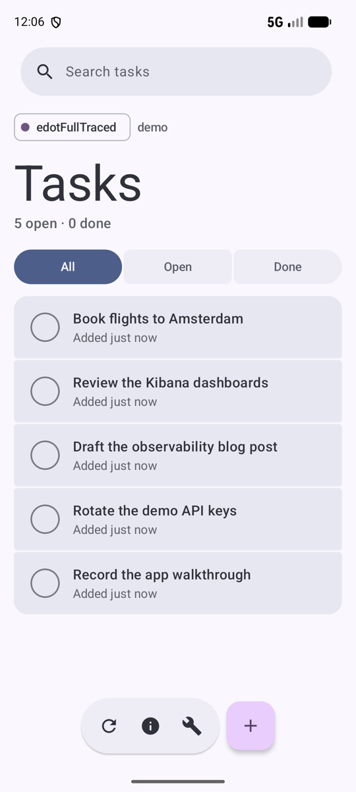
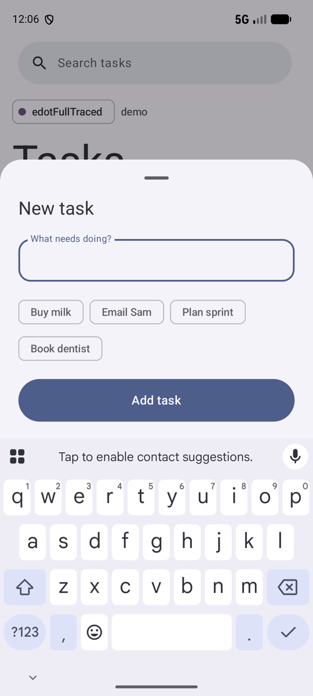
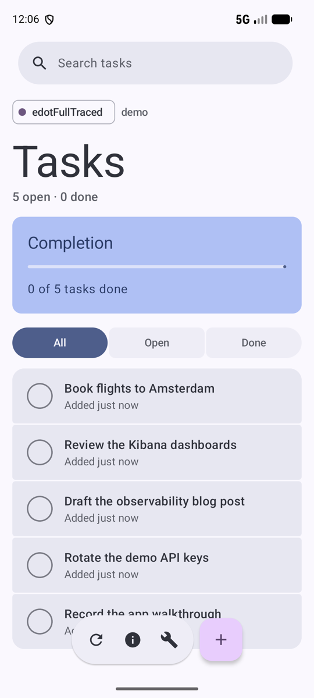
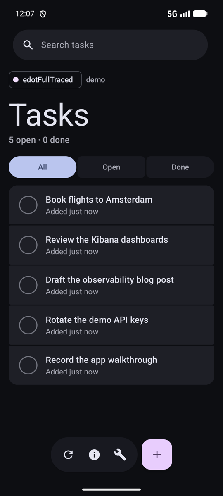
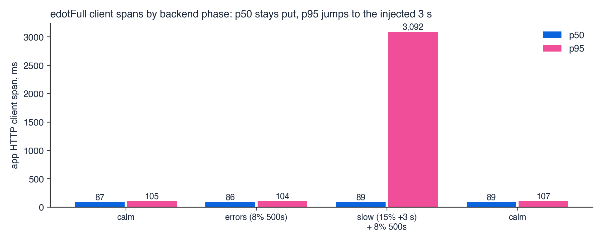
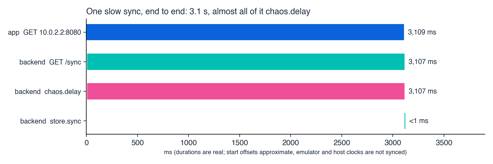

# Elastic Android OpenTelemetry: one app, five ways to instrument it

An Android to-do app ("Tasks") built five ways, plus a small backend and a load generator. The UI, the backend
calls and the injected failures are identical; only the telemetry stack changes. Run a flavor, drive it, then
compare what each one sends to Elastic and what shows up in Kibana (traces, crashes, sessions, dashboards).

## The app

A small to-do app ("Tasks") built with Jetpack Compose and Material 3. You can add, complete, delete, search and sync tasks against the
bundled backend. The chip under the search bar shows which telemetry flavor is running (here `edotFullTraced`) and the user id.
The wrench opens a debug sheet that can trigger a crash or an 8-second hang, so there is something to observe.

<table>
  <tr>
    <td></td>
    <td></td>
    <td></td>
    <td></td>
  </tr>
  <tr><td align="center">Task list</td><td align="center">New task</td><td align="center">Completion summary</td><td align="center">Dark theme</td></tr>
</table>

```
 Android app (5 flavors) ──OTLP/HTTP──▶ Elastic Observability ◀──OTLP/HTTP── backend (optional spans)
        │                                      │
        └── HTTP + traceparent ──▶ backend/server.py   Kibana: APM, Discover, [Android OTel] dashboards
```

## The five flavors

| Flavor | What it is | Package id | `service.name` |
|---|---|---|---|
| `bare` | No OpenTelemetry. A hand-written timer around each HTTP call, POSTed as JSON to Elasticsearch `_bulk`. | `dev.edotdemo.telemetry.bare` | `mobile-demo-android-bare` |
| `otel` | The upstream `opentelemetry-android` agent, as shipped: one init call, nothing else. | `...telemetry.otel` | `mobile-demo-android-otel` |
| `edot` | Elastic Distribution of OpenTelemetry (EDOT) Android, **agent only**: one init call, as its getting-started page says. | `...telemetry.edot` | `mobile-demo-android-edot` |
| `edotFull` | `edot` plus the documented **okhttp** and **crash** Gradle plugins. HTTP client spans, `traceparent`, crash logs. | `...telemetry.edotfull` | `mobile-demo-android-edotfull` |
| `edotFullTraced` | `edotFull` plus one file that turns the app's own moments (taps, screen views, sync, launch, lifecycle) into spans. | `...telemetry.edotfulltraced` | `mobile-demo-android-edotfulltraced` |

The flavors are untuned on purpose: no manual spans or extra attributes except in `edotFullTraced`. What differs in
Kibana is what each library collects by itself. All flavors install side by side.

### How the app is instrumented

1. **Gradle** (`android/app/build.gradle.kts`): three plugins at 1.10.0: `co.elastic.otel.android.agent`, `...instrumentation.okhttp`, `...instrumentation.crash`. The flavor filter at the bottom of the file strips the agent from `bare` and `otel`, and the plugin libraries from `edot`, so each APK contains only its own stack.
2. **Start** (`DemoApp.kt`): `AppTelemetry.start(this)`. Each flavor has its own `AppTelemetry` under `android/app/src/<flavor>/`, behind one shared facade (`start`, `action`, `event`, `flush`, `callFactory`).
3. **Automatic** (`edotFull`, `edotFullTraced`): the plugins weave bytecode, so OkHttp calls get client spans and a `traceparent` header and crashes become `app.crash` logs.
4. **Your moments** (`edotFullTraced` only, `src/edotFullTraced/.../AppTelemetry.kt`): `action("sync") { ... }` starts a span and makes it current, so the HTTP span is its child and the backend span follows. `event(...)` records an instant span.

## Repository layout

```
android/    Gradle project (Compose + Material 3). Flavors: bare, otel, edot, edotFull, edotFullTraced
backend/    server.py: task API, chaos controls, local telemetry sink, optional OTel spans (Python 3.9+)
loadtest/   wave.py, scenario.sh, chaos.sh, devices.sh: many sessions and a failure timeline
elastic/    Scripts for the bare flavor: index template, SLOs, dashboard (Elasticsearch/Kibana APIs)
docs/       App screenshots and result data from our runs (docs/traces)
DESIGN.md   What is tracked, where crashes and ANRs are injected, how load is simulated
```

## Prerequisites

- **Android Studio** (its bundled JDK is used for Gradle) and the Android SDK, with an emulator image. This project used `system-images;android-37.0;google_apis;arm64-v8a` and an AVD named `tele-37`; any recent AVD works.
- **Python 3.9+** for the backend and load scripts.
- **An Elastic deployment** that accepts OTLP: an Elastic Cloud project (managed OTLP endpoint), a self-managed stack with an EDOT Collector, or Elasticsearch 9.5 with its `_otlp` endpoint. Without any cluster you can still run everything against the backend's local sink (below).

## Quick start

**1. Start the backend** (the app's API; resets on restart)
```
python3 backend/server.py --port 8080
```

**2. Configure the app** (gitignored file; never commit keys)
```
cp android/telemetry.properties.example android/telemetry.properties
```

| Key | Used by | Notes |
|---|---|---|
| `OTLP_ENDPOINT`, `OTLP_API_KEY` | otel, edot, edotFull, edotFullTraced | OTLP/HTTP endpoint and an API key allowed to write `traces-*`, `logs-*`, `metrics-*`. |
| `ES_URL`, `ES_API_KEY` | bare | Elasticsearch endpoint; the key needs `create_index` and `index` on `mobile-bare-telemetry`. |
| `TARGET_BASE_URL` | all | The backend. From an emulator your Mac is `http://10.0.2.2:8080`. |

If a flavor's endpoint is empty, that flavor runs without exporting. The defaults point at the backend's `/sink` URLs, so
`curl localhost:8080/admin/sink` shows what each flavor sent, with no cluster.

**3. Build and install**
```
cd android
export JAVA_HOME="/Applications/Android Studio.app/Contents/jbr/Contents/Home"   # macOS; or any JDK 17+
./gradlew installBareDebug installOtelDebug installEdotDebug installEdotFullDebug installEdotFullTracedDebug
```
Rebuild after changing `telemetry.properties`: the values are compiled into the app. Start an emulator first
(`emulator -avd tele-37`), and run `adb shell settings put global hide_error_dialogs 1` so an ANR kills the app instead of showing a dialog.

**4. Drive it**

By hand: open the app and tap (the Debug button triggers a manual crash or an 8 s hang). Hands-off:
```
loadtest/scenario.sh edotFullTraced 10         # flavor, minutes: calm -> 8% errors -> 15% slow (+3 s) -> calm
python3 loadtest/wave.py --mode edotFull --minutes 5 --faults mild --vusers 3    # just the app load, no timeline
loadtest/chaos.sh calm|errors|slow|drift       # change the backend while apps run
```
`scenario.sh` resets the backend to calm before each phase. For one app launch:
```
adb shell am start -n dev.edotdemo.telemetry.edotfulltraced/dev.edotdemo.MainActivity \
  --ez autopilot true --es user u-1 --es persona finisher --es faults mild --ei duration 60 --ei vusers 3
```

**5. Send backend spans too** (optional; needed for end-to-end traces)
```
pip install opentelemetry-sdk opentelemetry-exporter-otlp-proto-http
export OTEL_EXPORTER_OTLP_HEADERS="Authorization=ApiKey%20<your key>"      # note %20 for the space
python3 backend/server.py --otlp https://<your-ingest-endpoint>:443
```
The backend then emits a SERVER span per request (continuing the app's `traceparent`) with `chaos.delay` and `store.<op>` children.
Send the app and the backend to the **same** cluster, or the trace won't join.

## See it in Kibana

- **Dashboards (Android flavors with OTel):** Integrations → search **Android OpenTelemetry Assets** (`otel_android_dashboards`) → Install, then open **[Android OTel] Application Overview** and drill into **Exception Details**. The dashboards read `logs-generic.otel*` and `traces-generic.otel*` filtered on `os.name: "Android"`, and need `session.id`, `service.name`, `service.version` and device fields. Docs: https://www.elastic.co/docs/reference/integrations/otel_android_dashboards
- **Traces:** Applications → Service inventory → pick a service → Transactions → a transaction → waterfall. With `edotFullTraced` the transactions are named `task.create`, `sync`, `screen.view`; with `edotFull` they are `GET 10.0.2.2:8080`.
- **Raw data:** Discover on `traces-generic.otel-default` and `logs-generic.otel-default` (bare: data view on `mobile-bare-telemetry`).
- Filter everything on `service.name`.

## What we saw

Scripted 10-minute runs on one emulator, edotFull and edotFullTraced, against an Elastic Cloud project. Test runs, not benchmarks. Raw data is in `docs/traces/`.



- **End to end works with `edotFull`:** 96% of traces contained both the app's client span and the backend span.
- **Latency by backend phase** (`edotFullTraced`, tap spans, p50 / p95 ms): calm 87/106, errors 90/109, slow 95/3,095, calm 91/111. Server time was the injected `chaos.delay`; the in-memory work took under 1 ms.
- **Logs are sparse:** the edot flavors export only `app.crash` as logs; sessions and spans carry the rest.
- **Waterfall start offsets are approximate:** the emulator and host clocks are not synced. Durations and parent/child links are correct.



## Elastic features and tiers

Checked 2026-11-01 against Elastic's docs, the subscriptions page and the cluster's Fleet API. Tiers change; recheck before relying on this.

| Feature | Tier | Billing | Notes |
|---|---|---|---|
| Android OpenTelemetry Assets package (`otel_android_dashboards`) | Basic | none | Fleet reports `license: basic`. Needs Kibana 8.19.20+, 9.3.9+, 9.4.5+ or 9.5.0+. |
| APM app, distributed tracing | Basic | none | From the subscriptions page. |
| Managed OTLP endpoint | Elastic Cloud only | usage-billed if the project is Serverless | Used by this project's runs. A self-managed route: EDOT Collector or Elasticsearch 9.5 `_otlp`. |
| Elasticsearch `_bulk` (bare flavor) | Basic | none | Core API. |
| SLOs (`elastic/slos`, bare flavor) | not checked | none | Verify before relying on it. |

## Troubleshooting

- **`Unable to locate a Java Runtime`:** set `JAVA_HOME` to Android Studio's bundled JDK, as in step 3.
- **No data in Kibana:** confirm the app's `OTLP_ENDPOINT` and key (then rebuild), that the emulator can reach the endpoint, and widen the time range. Check Discover for `os.name: "Android"` in `traces-generic.otel*`.
- **App can't reach the backend:** use `10.0.2.2` from an emulator, and confirm `curl localhost:8080/admin/stats` works on the host.
- **App and backend spans don't join:** they must go to the same cluster, and the app flavor must be `edotFull` or `edotFullTraced` (the others send no `traceparent`).
- **Dashboards empty:** the Android package filters on `os.name: "Android"` and needs `session.id`; confirm both on your documents.

## Security notes

This is a demo. Read these before you adapt it.

- **API keys:** `android/telemetry.properties` holds them and is gitignored. They are compiled into the app (`BuildConfig`), so anyone with the APK can read them. Use keys that can only write this telemetry, never an admin key, and rotate any key that was shared.
- **Backend:** `backend/server.py` has no authentication and exposes admin and chaos endpoints. It binds to `127.0.0.1` by default; an emulator reaches it through `10.0.2.2`. Use `--host 0.0.0.0` only on a network you trust, for example to test a physical phone.
- **Cleartext HTTP:** only debug builds allow it (`android/app/src/debug/AndroidManifest.xml`), because the demo backend is plain HTTP. Release builds block it. The release build type is signed with the debug key, so it is not a production configuration.

## More

`DESIGN.md` (what is tracked and how load is simulated), `android/UI_NOTES.md` (the Compose UI).
